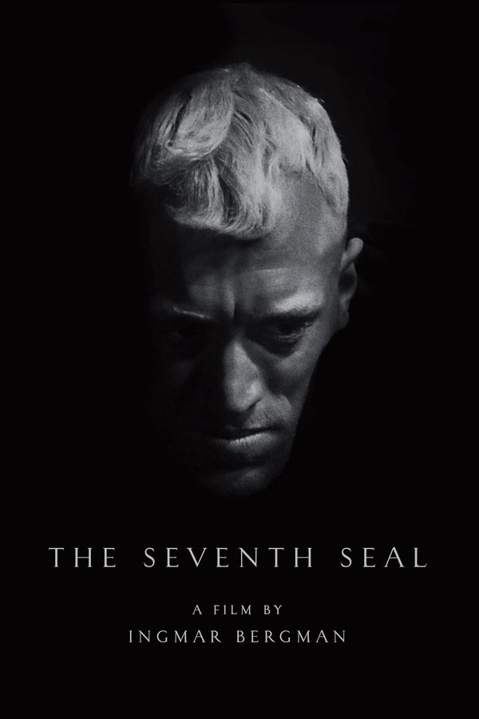
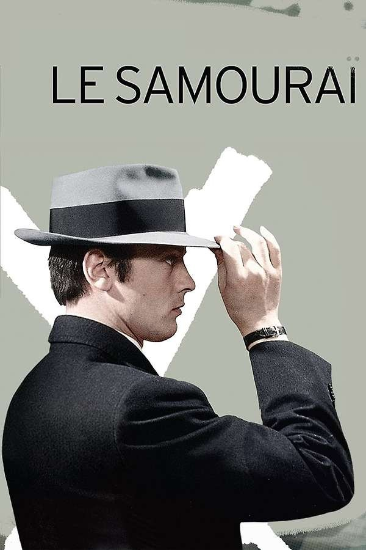
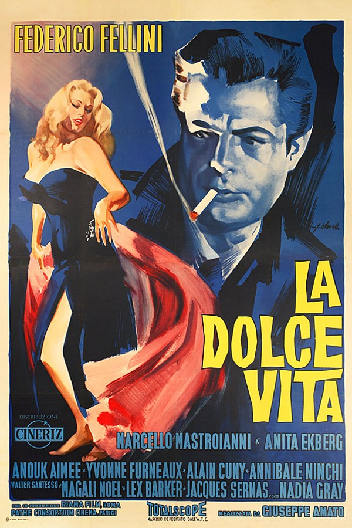

<!--
HOW TO ADD A RECOMMENDATION (open in Source mode)
Under its heading, replace the "coming soon" block with a list, one line per pick:

- ***The Title*** · Author or director. A sentence on why it's worth your time.

For a place:

- **Kyoto, Japan**. A sentence on what to see, or why it stayed with you.

The *** around a title make it bold italic, the way book and film titles appear elsewhere on the site.

The top five films' posters are in the films/ folder (seventh-seal.jpg, 2001.jpg, days-of-heaven.jpg,
le-samourai.jpg, la-dolce-vita.jpg). To change a poster, replace its file; until a file is there, the box shows the rank.

Every section and subsection starts closed, and its heading opens it (the script in _head-recs.html does this).
A subsection with {.open} after its heading starts open when its section is opened.

ART: each artist is one <figure class="art"> block in the Art section; copy one and change its links, title and
dates. The image is a public-domain file on Wikimedia Commons, loaded by its file name
(https://commons.wikimedia.org/wiki/Special:FilePath/FILE_NAME?width=960). For a work still under copyright,
leave out the  and the frame shows the title, linking to where the work can be seen.
-->

## Books

::: status
in no particular order
:::

### Drop everything and read {.open}

- ***The Society of Mind*** · Marvin Minsky, 1986
- ***I Am a Strange Loop*** · Douglas Hofstadter, 2007
- ***The Beginning of Infinity*** · David Deutsch, 2011

### Fiction

::: status
first picks coming soon
:::

### Non-fiction

::: status
first picks coming soon
:::

### Philosophy

::: status
first picks coming soon
:::

## Movies

### My top five {.open}

::: status
ranked
:::

```{=html}
<div class="top-films">
  <figure class="film">
    <div class="poster"><span class="rank">1</span></div>
    <figcaption><span class="n">1</span><b><i>The Seventh Seal</i></b><span class="by">Ingmar Bergman, 1957</span></figcaption>
  </figure>
  <figure class="film">
    <div class="poster"><span class="rank">2</span></div>
    <figcaption><span class="n">2</span><b><i>2001: A Space Odyssey</i></b><span class="by">Stanley Kubrick, 1968</span></figcaption>
  </figure>
  <figure class="film">
    <div class="poster"><span class="rank">3</span></div>
    <figcaption><span class="n">3</span><b><i>Days of Heaven</i></b><span class="by">Terrence Malick, 1978</span></figcaption>
  </figure>
  <figure class="film">
    <div class="poster"><span class="rank">4</span></div>
    <figcaption><span class="n">4</span><b><i>Le Samouraï</i></b><span class="by">Jean-Pierre Melville, 1967</span></figcaption>
  </figure>
  <figure class="film">
    <div class="poster"><span class="rank">5</span></div>
    <figcaption><span class="n">5</span><b><i>La Dolce Vita</i></b><span class="by">Federico Fellini, 1960</span></figcaption>
  </figure>
</div>
```

### Science fiction

- ***Metropolis*** · Fritz Lang, 1927
- ***Stalker*** · Andrei Tarkovsky, 1979
- ***Blade Runner*** · Ridley Scott, 1982
- ***Gattaca*** · Andrew Niccol, 1997
- ***Donnie Darko*** · Richard Kelly, 2001
- ***Under the Skin*** · Jonathan Glazer, 2013
- ***Interstellar*** · Christopher Nolan, 2014
- ***Arrival*** · Denis Villeneuve, 2016
- ***Tenet*** · Christopher Nolan, 2020
- ***Dune: Part One*** and ***Part Two*** · Denis Villeneuve, 2021 and 2024

### Suspense

- ***Rope*** · Alfred Hitchcock, 1948
- ***Vertigo*** · Alfred Hitchcock, 1958
- ***Psycho*** · Alfred Hitchcock, 1960
- ***Purple Noon*** · René Clément, 1960
- ***La Piscine*** · Jacques Deray, 1969
- ***Memento*** · Christopher Nolan, 2000
- ***Prisoners*** · Denis Villeneuve, 2013

### Crime and noir

- ***Sunset Boulevard*** · Billy Wilder, 1950
- ***Le Cercle Rouge*** · Jean-Pierre Melville, 1970
- ***Chinatown*** · Roman Polanski, 1974
- ***Reservoir Dogs*** · Quentin Tarantino, 1992
- ***Pulp Fiction*** · Quentin Tarantino, 1994
- ***The Usual Suspects*** · Bryan Singer, 1995

### Dreams and puzzles

- ***Last Year at Marienbad*** · Alain Resnais, 1961
- ***Eyes Wide Shut*** · Stanley Kubrick, 1999
- ***Mulholland Drive*** · David Lynch, 2001
- ***Synecdoche, New York*** · Charlie Kaufman, 2008

### Drama

- ***The Magnificent Ambersons*** · Orson Welles, 1942
- ***One Flew Over the Cuckoo's Nest*** · Miloš Forman, 1975
- ***American Beauty*** · Sam Mendes, 1999
- ***Requiem for a Dream*** · Darren Aronofsky, 2000
- ***The Tree of Life*** · Terrence Malick, 2011
- ***Whiplash*** · Damien Chazelle, 2014
- ***Oppenheimer*** · Christopher Nolan, 2023

### Romance

- ***Casablanca*** · Michael Curtiz, 1942
- ***In the Mood for Love*** · Wong Kar-wai, 2000

### War and westerns

- ***The Good, the Bad and the Ugly*** · Sergio Leone, 1966
- ***Apocalypse Now*** · Francis Ford Coppola, 1979

## Art

::: status
by the artist's birth year
:::

```{=html}
<div class="art-grid">
  <figure class="art">
    <a class="frame" href="https://commons.wikimedia.org/wiki/Category:C%C3%A9notaphe_%C3%A0_Newton"><span class="stand-in"><i>Cenotaph for Newton</i><small>1784</small></span></a>
    <figcaption><a href="https://en.wikipedia.org/wiki/%C3%89tienne-Louis_Boull%C3%A9e"><b>Étienne-Louis Boullée</b></a> <span class="dates">1728–1799</span><span class="work"><i>Cenotaph for Newton</i>, 1784</span></figcaption>
  </figure>
  <figure class="art">
    <a class="frame" href="https://en.wikipedia.org/wiki/Carnation,_Lily,_Lily,_Rose"><span class="stand-in"><i>Carnation, Lily, Lily, Rose</i><small>1885–86</small></span></a>
    <figcaption><a href="https://en.wikipedia.org/wiki/John_Singer_Sargent"><b>John Singer Sargent</b></a> <span class="dates">1856–1925</span><span class="work"><i>Carnation, Lily, Lily, Rose</i>, 1885–86</span></figcaption>
  </figure>
  <figure class="art">
    <a class="frame" href="https://en.wikipedia.org/wiki/Dance_(Matisse)"><span class="stand-in"><i>Dance (I)</i><small>1909</small></span></a>
    <figcaption><a href="https://en.wikipedia.org/wiki/Henri_Matisse"><b>Henri Matisse</b></a> <span class="dates">1869–1954</span><span class="work"><i>Dance (I)</i>, 1909</span></figcaption>
  </figure>
  <figure class="art">
    <a class="frame" href="https://collection.cooperhewitt.org/objects/18468717"><span class="stand-in"><i>Study for Maximum Mass, Stage 4</i><small>1922</small></span></a>
    <figcaption><a href="https://en.wikipedia.org/wiki/Hugh_Ferriss"><b>Hugh Ferriss</b></a> <span class="dates">1889–1962</span><span class="work"><i>Study for Maximum Mass, Stage 4</i>, 1922</span></figcaption>
  </figure>
  <figure class="art">
    <a class="frame" href="https://en.wikipedia.org/wiki/The_Son_of_Man"><span class="stand-in"><i>The Son of Man</i><small>1964</small></span></a>
    <figcaption><a href="https://en.wikipedia.org/wiki/Ren%C3%A9_Magritte"><b>René Magritte</b></a> <span class="dates">1898–1967</span><span class="work"><i>The Son of Man</i>, 1964</span></figcaption>
  </figure>
  <figure class="art">
    <a class="frame" href="https://en.wikipedia.org/wiki/Rothko_Chapel"><span class="stand-in"><i>Rothko Chapel</i><small>Houston, 1971</small></span></a>
    <figcaption><a href="https://en.wikipedia.org/wiki/Mark_Rothko"><b>Mark Rothko</b></a> <span class="dates">1903–1970</span><span class="work"><i>Rothko Chapel</i>, Houston, 1971</span></figcaption>
  </figure>
  <figure class="art">
    <a class="frame" href="https://en.wikipedia.org/wiki/Slim_Aarons"><span class="stand-in"><i>Poolside Gossip</i><small>Palm Springs, 1970</small></span></a>
    <figcaption><a href="https://en.wikipedia.org/wiki/Slim_Aarons"><b>Slim Aarons</b></a> <span class="dates">1916–2006</span><span class="work"><i>Poolside Gossip</i>, 1970</span></figcaption>
  </figure>
</div>
```

## Podcasts

- ***632nm*** · Misha Shalaginov, Michael Dubrovsky and Xinghui Yin
- ***Dwarkesh Podcast*** · Dwarkesh Patel
- ***Moonshots*** · Peter Diamandis
- ***The Ezra Klein Show*** · Ezra Klein
- ***The Drive*** · Peter Attia
- ***Morning Brew Daily*** · Morning Brew
- ***All-In*** · Chamath Palihapitiya, Jason Calacanis, David Sacks and David Friedberg
- ***Fall of Civilizations*** · Paul Cooper
- ***Doom Debates*** · Liron Shapira
- ***The 3b1b Podcast*** · Grant Sanderson
- ***The AI Daily Brief*** · Nathaniel Whittemore

## Travel

::: status
first picks coming soon
:::
